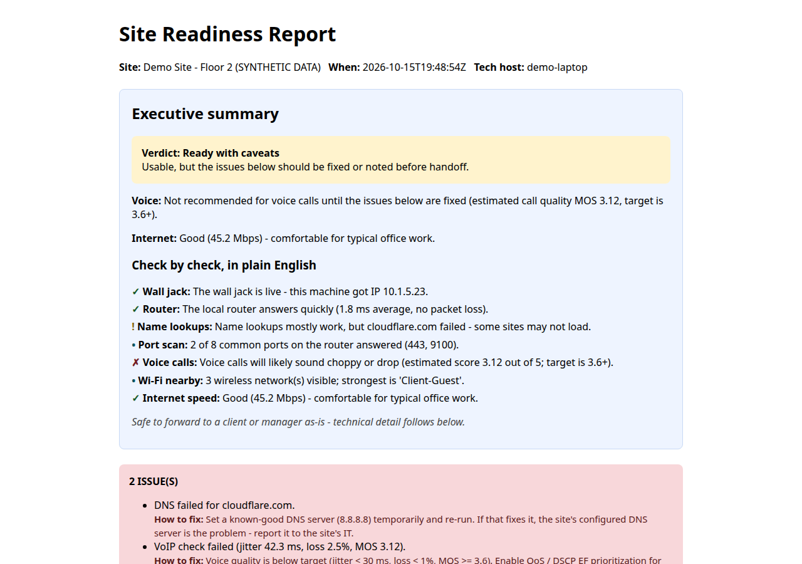

# site-readiness

Plug into the wall jack, run one command, hand the client a professional
**Site Readiness Report**.

Checks the local drop (IP, gateway, DNS), pings the gateway, verifies DNS
resolution, scans common service ports, summarizes visible Wi-Fi, and measures
real download speed — then renders it all as a shareable HTML report with a
clear READY / ISSUES verdict.

Built for field engineers doing site surveys, office buildouts, and
"the internet doesn't work" triage. Zero dependencies.



*A readiness report on demo data. Live demos: https://cnoteninja.github.io/Portfolio/*

## Quick start

```bash
python site_readiness.py --site "Client HQ - Floor 2"
```

Open `readiness.html`. That's your handoff doc.

Want to see what a finished report looks like first, with no network needed?

```bash
python site_readiness.py --demo
```

## Executive summary

Every report opens with a plain-English **Executive summary** section,
generated from the same results data as the technical detail below it:

- Overall verdict: **Ready** / **Ready with caveats** / **Not ready**
- A voice line in the form "Ready for ~N simultaneous voice calls",
  derived from the VoIP probe (MOS band), or a plain statement that voice
  isn't recommended until the issues are fixed
- Internet quality described in words ("Fast", "Good", "Adequate", "Slow")
  from the measured download speed
- One line per check area (wall jack, router, name lookups, port scan,
  voice calls, nearby Wi-Fi, internet speed), each in non-technical
  language

It's safe to forward to a client or manager as-is. Example (from `--demo`):

> **Verdict: Ready with caveats** - Usable, but the issues below should be
> fixed or noted before handoff.
>
> **Voice:** Not recommended for voice calls until the issues below are
> fixed (estimated call quality MOS 3.12, target is 3.6+).
>
> **Internet:** Good (45.2 Mbps) - comfortable for typical office work.
>
> - ✓ **Wall jack:** The wall jack is live - this machine got IP 10.1.5.23.
> - ✓ **Router:** The local router answers quickly (1.8 ms average, no packet loss).
> - ! **Name lookups:** Name lookups mostly work, but cloudflare.com failed - some sites may not load.
> - • **Port scan:** 2 of 8 common ports on the router answered (443, 9100).
> - ✗ **Voice calls:** Voice calls will likely sound choppy or drop (estimated score 3.12 out of 5; target is 3.6+).
> - • **Wi-Fi nearby:** 3 wireless network(s) visible; strongest is 'Client-Guest'.
> - ✓ **Internet speed:** Good (45.2 Mbps) - comfortable for typical office work.

## Remediation guidance

Every FAIL or warning in the report carries a **"How to fix"** line with a
concrete next step. The check → fix mapping lives in exactly one place -
the `REMEDIATION` dict in `site_readiness.py`, looked up by
`remediation_for(check_key)` - so covering a new check means adding one
dict entry, not editing the HTML.

## Demo mode

```bash
python site_readiness.py --demo
```

Builds a sample report from bundled synthetic data - a deliberate mix of
passes and failures (healthy drop, gateway, and speed; one DNS hiccup; a
failing VoIP probe) - so you can see the executive summary and the
remediation lines in action. No network needed; finishes in seconds.
Writes the usual `readiness.html` / `readiness.json` (clearly labeled
"SYNTHETIC DATA").

## Setup checker

```bash
python check_setup.py
```

Prerequisite check with plain-English `PASS` / `FAIL` / `SKIP` lines and
no tracebacks: Python version (3.8+), `site_readiness.py` imports cleanly,
`ping` availability, gateway reachability, DNS server reachability, the
VoIP fallback target (8.8.8.8:53), and both speed-test hosts - all with
short timeouts and graceful failure messages. Also confirms no config
file or pip packages are needed (the repo uses neither). Exit code 0
when nothing fails, 1 otherwise.

## What it checks

| Check | Why it matters |
|---|---|
| Local IP / gateway / DNS | Proves the drop is live and DHCP works |
| Gateway ping + loss | Catches bad cabling and overloaded links |
| DNS resolution timing | Slow DNS feels like slow internet |
| Ports 80/443/22/3389/9100/515/631/161 | Shows what the site actually exposes |
| VoIP readiness (jitter / loss / MOS) | Tells you if voice calls will sound good on this link |
| Visible Wi-Fi summary | Context for wireless complaints |
| Download speed test | A real number, not "it feels slow" |

## VoIP readiness check

VoIP calls fall apart on jitter and packet loss long before raw bandwidth
does, so the tool measures all three and estimates a MOS (Mean Opinion
Score) from 1.0 (bad) to 5.0 (great).

### Method — TCP approximation

Real voice traffic is UDP, and UDP jitter can't be measured from a laptop
without a cooperating echo server on the far end. This tool stays
dependency-free, so it uses a documented **TCP approximation** instead:

1. It opens 20 repeated small-payload TCP connections (SYN/SYN-ACK
   handshake time) to the gateway — or to 8.8.8.8:53 if no gateway is
   found. Port 443 is preferred when the port scan found it open.
2. **Latency** = mean round-trip time of the successful samples.
3. **Jitter** = mean absolute difference of consecutive RTTs (the same
   mean-deviation idea as RFC 3550 jitter).
4. **Loss** = share of samples that failed or timed out.

Treat this as a screening check, not a lab measurement: TCP handshakes
don't experience the same queuing as UDP voice packets, so real-world
voice jitter will typically be *equal or worse* than what this reports.

### MOS formula

A simplified E-model (ITU-T G.107) rating mapped to MOS. Exact formula:

```
H = 1 if delay > 177.3 ms else 0
R = 93.2 - 0.024*delay - 0.11*(delay - 177.3)*H - 30*ln(1 + 15*loss)
MOS = 1 + 0.035*R + 7e-6*R*(R - 60)*(100 - R)
```

- `delay` = latency + jitter (ms). The jitter buffer adds roughly the
  jitter amount to the effective one-way delay, so jitter feeds MOS
  through this term too.
- `loss` = packet loss probability (0–1).
- MOS is clamped to [1.0, 4.5] and rounded to 2 decimals.

### Thresholds

| Metric | Target |
|---|---|
| Jitter | < 30 ms |
| Packet loss | < 1% |
| Estimated MOS | ≥ 3.6 |

All three must hold for a **PASS**; any one failing (or the target being
unreachable) is a **FAIL**, and the failure shows up in the report's
verdict banner as well as the VoIP section.

### Example

```
Target          10.1.0.1:443
Latency         14.2 ms
Jitter           3.8 ms
Packet loss      0.0%
Estimated MOS    4.35   -> VoIP: PASS
```

## Files

| File | Purpose |
|---|---|
| `site_readiness.py` | The whole tool — checks + HTML/JSON report |
| `check_setup.py` | Prerequisite checker (PASS/FAIL lines, no tracebacks) |
| `readiness.html` | Generated report (git-ignored) |
| `readiness.json` | Raw results for your records (git-ignored) |

## Requirements

- Python 3.8+, no pip packages
- Windows / Linux / macOS

## License

MIT — use it on client jobs.
